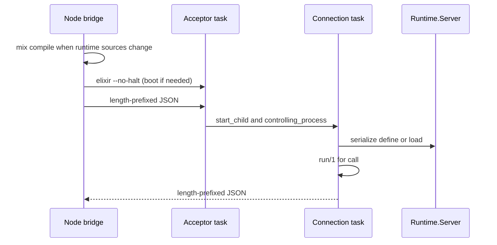

# Codex runtime

Alchemist's **codex runtime** is the `:runtime` OTP application: it validates slugs,
compiles codex entry trees into the live BEAM, maintains `meta.json`, and invokes
`run/1`. Hosts never call these modules directly. They send length-prefixed JSON to
the acceptor on `127.0.0.1` through the Node bridge or an equivalent TCP client.

The sources live in the `runtime/` **Mix project**. The Node bridge runs `mix compile`
there when those sources change; **Mix does not serve codex requests**. The bridge
boots a **long-lived BEAM** with `elixir --no-halt` and
`Application.ensure_all_started(:runtime, :permanent)`. Compiled entry modules stay
loaded in that node until it restarts.

## Supervision

`Runtime.Application` starts a `one_for_one` supervisor (3 restarts in 5
seconds). Children, in start order:

| Child | Restart | Owns | Role |
| --- | --- | --- | --- |
| `Runtime.TaskSupervisor` | supervisor | connection tasks | One temporary task per client |
| `Runtime.Server` | permanent | no sockets | Serializes `define` and `load` |
| `Runtime.Acceptor` | permanent task | listen socket | `Runtime.Server.accept/0` |

The acceptor calls `Task.Supervisor.start_child/2` and then
`:gen_tcp.controlling_process/2`. The connection task decodes one
length-prefixed JSON request and encodes the response. `call` runs `run/1` in
that task. Accept errors exit the acceptor instead of retrying in place. A
connection crash closes its socket and leaves the acceptor up. If the
supervisor gives up, the permanent application exits the VM.

## Module responsibilities

| Module | Responsibility |
| --- | --- |
| `Runtime.Application` | Supervisor for the task supervisor, serializer, and acceptor |
| `Runtime.Server` | Accept loop (in the acceptor task) and compile serialization (GenServer) |
| `Runtime.CLI` | Operation dispatch for `define`, `load`, `find`, `call` |
| `Runtime.Engine` | Orchestrates compile, metadata refresh, search, and `run/1` invocation |
| `Runtime.Compiler` | Compiles `functions/lib` and per-slug `.ex` trees; validates entry module |
| `Runtime.Codex` | Slug sanitization, paths, `meta.json`, discovery walk, `write_definition` |
| `Runtime.Metadata` | Extracts `@moduledoc` and `@spec` for metadata files |
| `AgentFn.Codex` | Dynamic dispatch helper (`call/2`, `list/0`) used from entry code |
| `AgentFn.Tool` | Behaviour marker for entry modules |

## Lifecycle



## Source and metadata layout

| Path | Content |
| --- | --- |
| `functions/<slug-path>/tool.ex` | Entry module source (`define` default target) |
| `functions/<slug-path>/**/*.ex` | Deep modules for the entry |
| `functions/<slug-path>/meta.json` | Discovery record (`find`); updated on load/define |
| `functions/lib/**/*.ex` | Shared `AgentLib.*` modules |

Default functions root is `../functions` relative to this Mix project.

## Development

```bash
mix deps.get
mix test
```

From the repository root:

```bash
(cd runtime && mix test)
node scripts/cli.mjs '{"op":"call","name":"echo","args":{}}'
```

## Environment variables

| Variable | Effect |
| --- | --- |
| `AGENT_FUNCTIONS_DIR` | Path to the capability tree (set by the Node bridge for codex calls) |
| `ALCHEMIST_STATE_DIR` | Live node files (`port`, `pid`) and the bridge's `stamp` (default `runtime/.alchemist`) |

## Limitations

- One BEAM node per bridge state directory; stale PIDs are replaced on the next boot.
- The acceptor restarts on the same port when it can. A dead node is replaced by the bridge.
- `"loaded"` in `meta.json` is disk bookkeeping; live code lives in the BEAM until restart.
- No sandbox: compilation and `run/1` use the host OS identity. See
  [Security boundary](../docs/reference/security.md).
- Operation contract: [Codex protocol](../docs/reference/protocol.md).

## Related reading

- [Architecture](../docs/concepts/architecture.md)
- [Host adapters](../docs/reference/hosts.md)
- [Domain language](../docs/concepts/domain-language.md)
